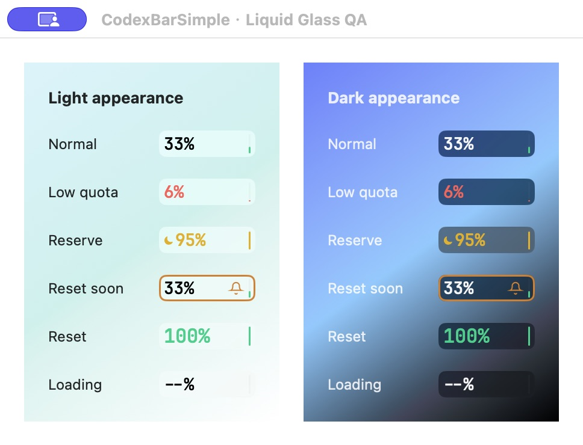
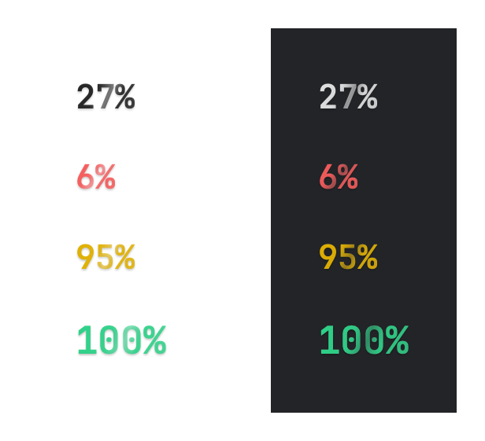

# Native Liquid Glass menu bar

Validated on an Apple Silicon Mac running macOS 26.5.1.

## Implementation

- Replaced the opaque, forced-dark card with native `glassEffect(.regular, in:)` on macOS 26+.
  Regular glass gives text a frosted backing; the initially tested clear variant was too transparent
  in the actual menu bar. Earlier systems retain a native translucent material fallback.
- Kept one live `NSHostingView` inside the existing status button instead of flattening glass into
  an `ImageRenderer` image. Reuse that host for quota changes and existing animations.
- Let normal text and the empty progress track follow the system appearance. Keep the existing
  accent, low-quota red, Luna Reserve gold, orange reminder border, and bell.
- Bind the hosting view to the application's effective appearance and observe changes, rather than
  inheriting the status button's potentially wallpaper-dependent appearance. Both modes retain the
  same regular frosted glass; changing the system theme does not require restarting or refreshing usage.
- Pass that appearance explicitly into SwiftUI's `colorScheme` environment as well as AppKit.
  Updating only `NSView.appearance` left the real menu bar light after a system Dark switch.
  Preserve the injected scheme when quota updates or animations replace the root view's content.
- Preserve the 80 × 22 pt card, 84 pt status item, font sizes, refresh intervals, and right-click-only
  Quit action. The hosting view passes mouse events through to the existing status button.
- Give the percentage a glass-inspired typography treatment: a translucent directional gradient and
  subpixel edge highlights. Keep JetBrains Mono, the existing sizes, and all semantic tones. The digits
  are not another native Liquid Glass surface: the native glass API adds a shape behind text rather
  than making its glyphs glass. No continuous animation or polling is added for this treatment.

## Verification

- `swift test --filter TraeMenuBarUsageRenderingTests`: all 7 focused tests passed, including a live-host
  light → dark → light regression with the parent set to the opposite appearance. Only the test process's
  appearance is changed; no system settings are modified. The regression checks the injected SwiftUI
  scheme too, and verifies it survives a subsequent quota refresh.
- `make check`: formatting, build, and all 40 tests in 9 suites passed. Live-account tests were not enabled.
- `./Scripts/package_app.sh`: release build and ad-hoc signing passed.
- A native QA window using the actual component verified normal, low-quota, reserve, upcoming-reset,
  reset-emphasis, and loading states in light and dark appearances. The screenshot below is of that
  QA window, not an offscreen rendering or a capture of the system menu bar.
- Replaced the installed per-user app with the built bundle and restarted its existing LaunchAgent.
  No Codex account configuration or login data was modified.
- With macOS already in Dark mode, native logs confirmed `NSAppearanceNameDarkAqua`; the user then
  confirmed the actual menu bar changed to dark frosted glass with a white percentage. This confirms
  the production display, not just the AppKit appearance property. Offscreen `ImageRenderer` output
  does not capture native Liquid Glass reliably and is not used as visual proof of this behavior.

Typography-only rendering in light and dark appearances (no native glass backing in this image):

The focused typography test renders the actual digit component separately from native glass and checks
nonempty pixels and unchanged compact bounds for normal, low-quota, reserve, and reset-emphasis states.

References: [Apple's custom Liquid Glass guidance](https://developer.apple.com/documentation/swiftui/applying-liquid-glass-to-custom-views)
and [NSHostingView](https://developer.apple.com/documentation/swiftui/nshostingview).
